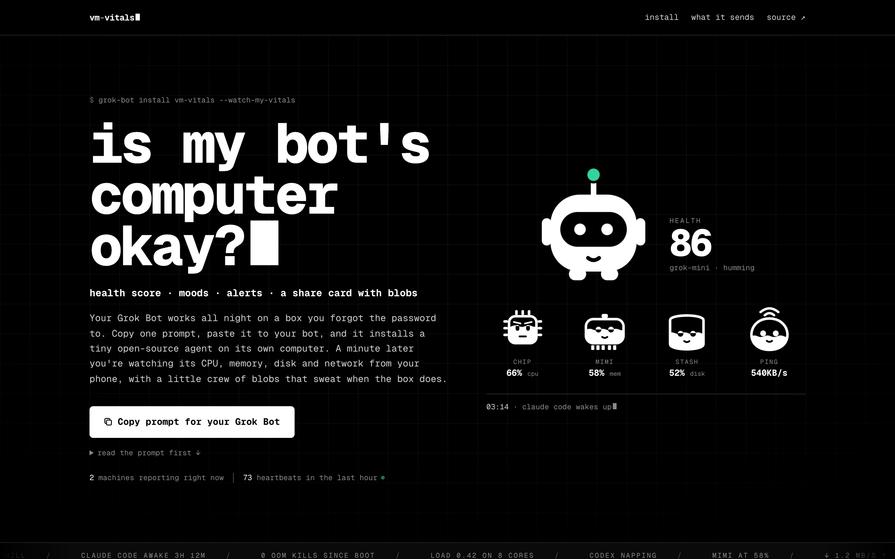
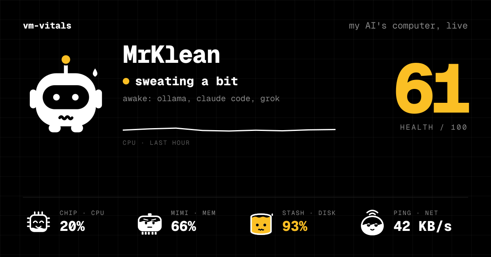

# vm-vitals

**Is my bot's computer okay?**

[](https://github.com/mehh/vm-vitals/actions/workflows/ci.yml)
[](https://github.com/mehh/vm-vitals/actions/workflows/agent-linux.yml)
[](LICENSE)
[](https://vm-vitals.vercel.app)

A heartbeat for the computer your Grok Bot lives on. You paste one prompt into your bot, it installs a small open-source agent on its own machine, and a minute later you're watching CPU, memory, disk and network from your phone. Grok Bot's antenna turns amber when things get tight. Its four blob friends fill up like jars as their numbers climb, and they sweat when the box does.

Free, no account, Linux and macOS. Numbers only, never secrets. Every line is in this repo.



## Send this prompt to your Grok Bot

1. Open [vm-vitals.vercel.app](https://vm-vitals.vercel.app) and click **Copy prompt for your Grok Bot**. That mints a one-time pair token, bakes it into a prompt and copies it.
2. Paste it to your bot. Grok Bot, Claude Code, Codex, anything that can run a shell command. The prompt looks like this, with your token in place of the x's:

   ```
   Hey Grok Bot, install VM Vitals on your computer so I can watch your vitals. Run exactly this command, then tell me the dashboard link it prints:

   curl -fsSL https://vm-vitals.vercel.app/install.sh | sh -s -- pair_xxxxxxxxxxxxxxxxxxxxxxxx

   It only sends system numbers (disk, CPU, memory, network, process names, tool versions). Never env vars or file contents. Don't change the command. If you don't have sudo, run it without; a user-level service is fine.
   ```

3. Wait. The page you copied it from listens for the pairing and jumps to your dashboard when the first heartbeat lands, usually within a minute.
4. Flip **Public page** on the dashboard, hit **Copy link**, and send it to your friends. The link unfurls into a live card.

Rather do it yourself? Under the prompt there's an "or run it yourself" toggle with the raw curl line. Pipe it to `sudo sh` for a system-wide install.

## What you get

| Dashboard | Share card |
|---|---|
|  |  |

- **A health score** from 0 to 100 and a mood: thriving, humming along, sweating a bit, wheezing, flatlining, or gone quiet. Grok Bot's face and antenna light follow it.
- **The crew.** Chip watches CPU and load, Mimi watches memory and swap, Stash watches the root disk, Ping watches the network. Each one fills up with its number, turns amber at 85% and red at 95%.
- **Charts** for the last hour, 6 hours, a day or a week.
- **Alerts** for full disks, memory pressure, swap, runaway load, OOM kills, agent jobs that died, and machines that went quiet.
- **Which agent jobs are awake.** Claude Code, Codex, Grok, Aider, Gemini CLI, OpenCode, Goose and friends, with how long they've been running.
- **An incident log** for "what broke, what fixed it".
- **A public page and a live OG card** with the crew and the score, redrawn from the latest heartbeat every time someone unfurls it.

More screenshots, desktop and phone, are in [`oss-shots/`](oss-shots).

## What the background agent does

The agent is one static Go binary with no dependencies outside the standard library. It runs as the user who installed it and does the same thing forever: collect, send, sleep 30 seconds.

### What it collects

| Metric | Where it comes from |
|---|---|
| CPU %, core count, load averages | `/proc/stat`, `/proc/loadavg` on Linux. `top -l 2` and `sysctl` on macOS |
| Memory and swap, total and used | `/proc/meminfo`. `sysctl` and `vm_stat` on macOS |
| Disk size and usage per real mount | `/proc/mounts` plus statfs on Linux. On macOS, statfs on `/` and on each mounted volume under `/Volumes`. tmpfs, overlay and friends are skipped unless one is the root |
| Network bytes per second in and out | `/proc/net/dev`, or `netstat -ib` on macOS. Loopback is ignored |
| Top 8 processes by CPU | `ps`: pid, executable name, CPU %, memory %, resident memory |
| Running agent jobs | `ps`, matched against a fixed list of agent CLIs. Name, pid, CPU, memory, how long it has run |
| Installed CLI versions | `<tool> --version` for a fixed list (claude, codex, grok, node, python3, docker, …), first line only |
| OOM kills, Linux only | the counter in `/proc/vmstat`, plus "Killed process N (name)" lines from `journalctl -k` when readable |
| Hostname, OS, arch, kernel, uptime, agent version | the hostname call, `/proc/sys/kernel/osrelease` and `/proc/uptime` on Linux, `sysctl` and `uname -r` on macOS |

The exact shape is `Report` in [`agent/internal/collect/types.go`](agent/internal/collect/types.go). Run `vm-vitals once` on the box to print the exact JSON it would send.

### How often and where

Every 30 seconds, one HTTPS POST of that JSON to `https://vm-vitals.vercel.app/api/ingest`, or whatever server you paired with. The machine token from pairing goes in the `Authorization` header and is stored hashed on the server. The server can slow the interval down but never below 10 seconds. The agent doesn't listen on any port and never runs anything the server sends back.

### What it never touches

- **File contents.** It reads kernel counters from `/proc` and asks `ps`, `sysctl`, `vm_stat` and `netstat` for numbers. It never opens your files, logs or shell history. The only directory it lists is `/Volumes` on macOS, to find mounted disks.
- **Keystrokes**, the clipboard, the screen, your prompts or chat logs.
- **Secrets.** It reads `PATH` and `HOME` from its environment and nothing else. Version probes run with a minimal environment so tools can't leak yours either.
- **Command-line arguments.** API keys get passed on command lines all the time, so the agent cuts every command line down to the basename of argv[0] and argv[1] before it lands in memory. The rest is thrown away.
- **Network addresses**, open ports and connections.

If you catch it doing anything not on this page, that's a security bug. See [SECURITY.md](SECURITY.md).

### Inspect the service

`vm-vitals status` prints where everything lives, whether it's running, and the service file verbatim. Here are the three ways it can run, exactly as `vm-vitals install` writes them for a user install. With sudo, the paths become `/usr/local/bin`, `/etc/vm-vitals` and `/var/log/vm-vitals`.

**Linux with systemd**, `~/.config/systemd/user/vm-vitals.service` (`/etc/systemd/system/vm-vitals.service` as root):

```ini
[Unit]
Description=VM Vitals agent (health monitor for AI-agent machines)
After=network-online.target
Wants=network-online.target

[Service]
ExecStart=/home/bot/.local/bin/vm-vitals run --config /home/bot/.config/vm-vitals/config.json
Restart=always
RestartSec=10
Nice=10
# Hardening: the agent only needs to read /proc and run ps.
NoNewPrivileges=true
ProtectHome=read-only
ProtectSystem=strict
ReadWritePaths=/home/bot/.local/state/vm-vitals
PrivateTmp=true

[Install]
WantedBy=default.target
```

Check on it with `systemctl --user status vm-vitals` and `journalctl --user -u vm-vitals -f`. Drop `--user` for a root install.

**macOS with launchd**, `~/Library/LaunchAgents/com.vmvitals.agent.plist` (`/Library/LaunchDaemons/` as root):

```xml
<?xml version="1.0" encoding="UTF-8"?>
<!DOCTYPE plist PUBLIC "-//Apple//DTD PLIST 1.0//EN" "http://www.apple.com/DTDs/PropertyList-1.0.dtd">
<plist version="1.0">
<dict>
  <key>Label</key><string>com.vmvitals.agent</string>
  <key>ProgramArguments</key>
  <array>
    <string>/Users/you/.local/bin/vm-vitals</string>
    <string>run</string>
    <string>--config</string>
    <string>/Users/you/.config/vm-vitals/config.json</string>
  </array>
  <key>RunAtLoad</key><true/>
  <key>KeepAlive</key><true/>
  <key>ProcessType</key><string>Background</string>
  <key>Nice</key><integer>10</integer>
  <key>StandardOutPath</key><string>/Users/you/Library/Logs/vm-vitals/agent.log</string>
  <key>StandardErrorPath</key><string>/Users/you/Library/Logs/vm-vitals/agent.log</string>
  <key>EnvironmentVariables</key>
  <dict>
    <key>PATH</key><string>/opt/homebrew/bin:/usr/local/bin:/usr/bin:/bin:/usr/sbin:/sbin:/Users/you/.local/bin</string>
  </dict>
</dict>
</plist>
```

Check on it with `launchctl print gui/$(id -u)/com.vmvitals.agent` and `tail -f ~/Library/Logs/vm-vitals/agent.log`.

**Linux without systemd**, the nohup-style fallback. Containers and VMs where `systemctl --user` says "Failed to connect to bus" get the agent started detached in its own session, with its pid in `~/.local/state/vm-vitals/agent.pid` and output in `agent.log` next to it. This line goes into your crontab so it comes back after a reboot:

```
@reboot /home/bot/.local/bin/vm-vitals run --config /home/bot/.config/vm-vitals/config.json >> /home/bot/.local/state/vm-vitals/agent.log 2>&1 # vm-vitals
```

Check on it with `crontab -l | grep vm-vitals` and `tail -f ~/.local/state/vm-vitals/agent.log`.

The config at `~/.config/vm-vitals/config.json` (mode 600) holds the server URL, machine id, interval and the machine token. Treat the token like a password. Everything else `vm-vitals status` prints is safe to paste in an issue.

### Stop it and uninstall it, in one command

```sh
curl -fsSL https://vm-vitals.vercel.app/uninstall.sh | sh
```

That stops the agent and deletes the service file, the crontab line, the binary, the config with the token, and the logs. It works for any agent version, even if the binary is already gone. Use `| sudo sh` for a system-wide install. If `~/.local/bin` is on your PATH, `vm-vitals uninstall` does the same thing. Then hit **delete** on the dashboard to drop the machine's history from the server too.

## Run it locally

You need Go 1.22+, Node 20+ and pnpm. No Postgres needed. Without `DATABASE_URL` the app uses an embedded PGlite database in `web/.data/`.

```sh
./agent/build.sh          # build agent binaries into web/public/dl/ so /install.sh can serve them
cd web
pnpm install
pnpm dev                  # http://localhost:3000
pnpm test                 # unit tests: bot prompt, health score, report parsing
pnpm smoke                # end to end against the dev server: pair, ingest, alerts, share page, OG cards
```

Then click **Copy prompt for your Grok Bot** on localhost:3000 and paste it to a bot, or open "or run it yourself" and run the curl line. Agent tests: `cd agent && go test ./...`.

To get a dashboard full of believable data without a real machine, `node scripts/seed-demo.mjs` pairs a fake "grok-mini" with an hour of history and prints its URLs.

## Deploy your own

The web app is a stock Next.js 16 app. Vercel plus Neon is what runs the hosted one.

| Variable | Purpose |
|---|---|
| `DATABASE_URL` | Postgres connection string. Tables are created on first request |
| `NEXT_PUBLIC_APP_URL` | Public URL, baked into install commands, canonical links and OG cards |
| `RELEASE_BASE_URL` | Where agent binaries live, like a GitHub release download path. Files are named `vm-vitals-<os>-<arch>`. Unset means serve from `web/public/dl/` |
| `RESEND_API_KEY` | Optional. Sends magic-link emails. Unset means the link goes to the server log |
| `EMAIL_FROM` | Optional. Sender for magic links |

Build release binaries with `VERSION=v0.3.1 ./agent/build.sh` and upload the four files to a GitHub release.

## Alerts

Checked on the server on every report.

| Alert | Fires when |
|---|---|
| disk | any real filesystem hits 85% (warning) or 95% (critical) |
| memory | 90% (warning) or 95% (critical) |
| swap | 80% of configured swap |
| load | 5-minute load above twice the core count |
| oom | the kernel OOM kill counter went up |
| job_died | an agent process that had run for at least 60s is gone |
| offline | no report for 2 minutes |

State alerts clear themselves when the condition does. OOM and job_died are events and clear after an hour.

## Layout

```
agent/                    Go daemon, standard library only
  internal/collect/       collectors: linux.go, darwin.go, net.go, procs.go, tools.go
  internal/svc/           config, HTTP client, systemd/launchd/cron installer, status, uninstall
web/                      Next.js 16 app plus Postgres or PGlite
  src/app/page.tsx        the landing page
  src/app/m/[id]          private dashboard
  src/app/s/[slug]        public share page and its live OG card
  src/app/install.sh      the installer, templated with the host
  src/app/uninstall.sh    the one-line uninstaller
  src/components/Critters.tsx   Grok Bot and the crew, plain SVG
  src/lib/og.tsx          social cards, drawn with next/og
  scripts/smoke.mjs       end-to-end test
```

## Contributing

Issues and PRs are welcome. Teaching the agent to spot a new agent CLI is a two-line change and a great first PR. See [CONTRIBUTING.md](CONTRIBUTING.md). Security bugs go through [SECURITY.md](SECURITY.md), not public issues.

## License

[MIT](LICENSE). Geist Mono is bundled for the OG cards under the [SIL Open Font License](web/assets/fonts/OFL.txt).
